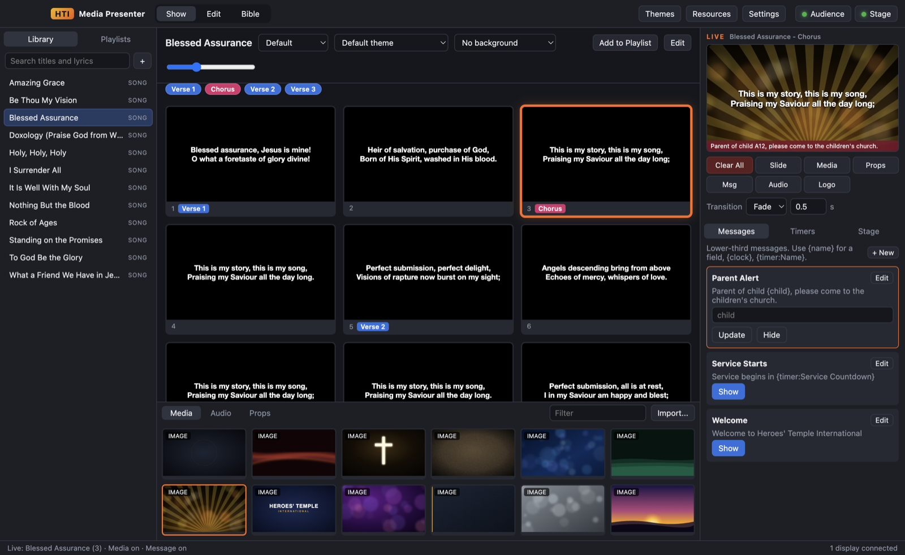

# HTIMedia Presenter

Worship and live-presentation software for **Heroes' Temple International**, built by GABCEL Labs.
It runs **fully offline** on **macOS** and **Windows**: songs, scripture, media, the audience screen,
the stage screen and the phone remote all run on the church computer, with no cloud account.



## Download

Get the latest installer from **[Releases](https://github.com/gdompey/htimedia-presenter/releases/latest)**:

| Platform | File |
|---|---|
| macOS (Apple Silicon) | `HTIMedia-Presenter-<version>-mac-arm64.dmg` |
| macOS (Intel) | `HTIMedia-Presenter-<version>-mac-x64.dmg` |
| Windows 10/11 | `HTIMedia-Presenter-Setup-<version>-win-x64.exe` (installer) or `...-portable.exe` (no install) |

The builds are not code-signed yet:

- **macOS:** the first time, right-click the app, choose **Open**, then **Open** again. If macOS says the app is "damaged", run
  `xattr -cr "/Applications/HTIMedia Presenter.app"` in Terminal once.
- **Windows:** if SmartScreen appears, click **More info**, then **Run anyway**.

## Resources download themselves after install

On first launch the app connects to this repository's
[`resources` release](https://github.com/gdompey/htimedia-presenter/releases/tag/resources), downloads the
resource packs, checks each one's SHA-256, and stores them on the computer. After that, nothing needs the internet.

| Pack | Contents | Default |
|---|---|---|
| KJV Bible | King James Version (1769) | yes (also bundled in the installer) |
| ASV Bible | American Standard Version (1901) | yes |
| BBE Bible | Bible in Basic English | optional |
| YLT Bible | Young's Literal Translation (1898) | optional |
| Core Themes | Worship, scripture, sermon, lower-third and announcement themes | yes (bundled) |
| Core Backgrounds | 12 still and motion backgrounds | yes (bundled) |
| Classic Hymns | 12 public-domain hymns | yes (bundled) |

If the first launch is offline, the bundled starter set (KJV, themes, backgrounds, hymns) is installed, and the
rest downloads the next time the app is online. **Resources** in the toolbar adds, updates or removes packs.
Installed packs update automatically when a new version is published. You can turn that off in Settings.

## Features

- **Library and playlists:** songs, sermons and announcements. Build a service order from the Library by drag and drop,
  add headers and placeholders, and save **playlist templates** for the weekly service.
- **Presentation editor:** paste lyrics and they split into groups (Verse, Chorus, Bridge...) and slides.
  Edit text, notes, labels and colours, and use **arrangements** to repeat a chorus without copying slides.
- **Bible:** type `John 3:16-18`, `Ps 23` or `1 Cor 13:4-7`, browse books and chapters, search by keyword,
  and show **several translations side by side**. Save a passage to the library or a playlist.
- **Audience screen:** layered output (background media, slide, props, lower-third message, logo) with fade or cut
  transitions, auto-fit text, and image and video backgrounds.
- **Stage screen:** current and next slide, slide notes, clock, running timer, and a flashing stage message. Four layouts.
- **Timers:** countdown, countdown to a time of day, and stopwatch. Use them in messages with `{timer:Name}`.
- **Messages:** lower thirds with fill-in fields, e.g. `Parent of {child}, please come to the nursery`.
- **Clear layers:** Clear All, Slide, Media, Props, Messages, Audio and Logo (F1–F7).
- **Media bin:** drag in images, videos and audio. Set backgrounds per presentation, per slide or per theme.
- **Themes:** font, size, colours, alignment, text box position, shadow, outline, text backing (lower thirds) and background.
- **Phone remote:** any phone or tablet on the same Wi-Fi network can step slides and clear layers. It is PIN-protected and off by default.
- **Import from ProPresenter:** songs from ProPresenter 4, 5, 6 and 7 (`.pro4`, `.pro5`, `.pro6`, `.pro`), with groups,
  arrangements, slide notes and CCLI details. `.proPlaylist` files come in as playlists. You can also import a whole
  ProPresenter library folder at once.
- **PDF and PowerPoint import:** each page becomes a full-screen slide, rendered locally. PowerPoint, Keynote and
  OpenDocument files are converted with LibreOffice (free), Keynote or PowerPoint, whichever is installed, and speaker
  notes are kept. Without a converter, PowerPoint slide text is imported instead.
- **Video controls:** play, pause, restart, scrub, time remaining, volume and mute, plus what happens when a video
  ends (loop, stop, clear, or go to the next slide).
- **Import and export:** `.txt` lyrics and `.htip` presentation files.
- **Safe by design:** deleted songs go to *Recently Deleted*, and removed media goes to a `Removed Media` folder.

See the **[User Guide](docs/USER-GUIDE.md)** for how to run a service.

## Develop

Requires Node.js 20+.

```bash
npm install
npm start            # run the app
npm test             # unit tests (lyrics parser, scripture references, timers)
npm run selftest     # drives the real UI, screenshots every window, fails on renderer errors
npm run dist:mac     # build .dmg/.zip into dist/
npm run dist:win     # build the Windows installer (best run on Windows or in CI)
```

Pushing a tag like `v1.0.1` builds the macOS and Windows installers in GitHub Actions and attaches them to a release.

### Project layout

```
src/main/        Electron main process: windows, data store, resource packs, Bible, LAN remote
src/shared/      Pure logic shared by all processes (lyrics parser, scripture references, timers)
src/renderer/    control (operator UI), output (audience), stage, remote (phone page), common slide renderer
scripts/         resource pack builder, icon renderer, self-test runner
resources/bundled/  starter packs shipped inside the installer
```

### Publishing resource packs

See [docs/RESOURCES.md](docs/RESOURCES.md). In short: edit `scripts/resource-src/`, bump the version in
`scripts/build-resources.js`, run `npm run build:resources`, and upload `dist-resources/*` to the `resources` release.

## Credits and licences

- App code: MIT licence (see `LICENSE`).
- Bible texts: KJV, ASV, BBE and YLT are public domain in the United States. The source data comes from
  [scrollmapper/bible_databases](https://github.com/scrollmapper/bible_databases).
- Hymns in the starter pack are public domain. Backgrounds and the icon are original artwork.
- HTIMedia Presenter is an independent product. It is not affiliated with or endorsed by Renewed Vision or ProPresenter.
  The app was designed from public documentation of common worship-presentation workflows. No code or assets from
  other products are included.
